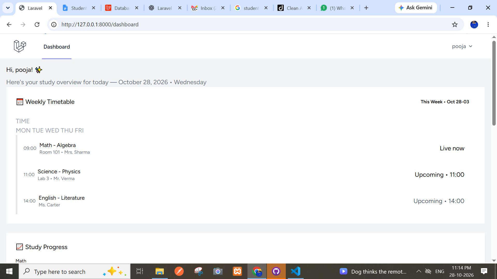

# Time Table Tracker

A student-focused web application designed to organize study schedules, track homework, and monitor study progress.


## Features

- **User Authentication:** Register and log in using Laravel Breeze.
- **Google Login:** Authenticate using a Google account through Laravel Socialite.
- **Student Dashboard:** A modern dashboard with a sidebar and summary cards.
- **Study Schedule UI:** Display upcoming study sessions.
- **Homework UI:** Display pending assignments and tasks.
- **Progress Overview UI:** Visual study-load chart and progress indicator.
- **Responsive Design:** Tailwind CSS layout for different screen sizes.

## Tech Stack

- **Backend:** PHP, Laravel
- **Frontend:** Blade Templates, Tailwind CSS, JavaScript
- **Authentication:** Laravel Breeze, Laravel Socialite, Google OAuth 2.0
- **Database:** SQLite (local development)
- **Build Tools:** Composer, NPM, Vite
- **Version Control:** Git and GitHub

## Prerequisites

Install the following before running the project:

- PHP and required Laravel extensions
- Composer
- Node.js and NPM
- Git

## Local Setup

### 1. Clone the repository

```bash
git clone
```

### 2. Install PHP dependencies

```bash
composer install
```

### 3. Configure environment

```bash
copy .env.example .env
php artisan key:generate
```

Update `.env` with your local database and Google OAuth settings. Never commit real credentials or secret keys.

### 4. Configure the database

Set the database connection in `.env` according to your local setup.

For SQLite, create the database file if it does not already exist, then run:

```bash
php artisan migrate
```

### 5. Configure Google Login

Set the following environment variables in `.env`:

```env
GOOGLE_CLIENT_ID=
GOOGLE_CLIENT_SECRET=
GOOGLE_REDIRECT_URI=http://127.0.0.1:8000/auth/google/callback
```

Use credentials from your Google Cloud OAuth client. Never publish the client secret.

### 6. Install frontend dependencies

```bash
npm install
npm run build
```

### 7. Start the application

In one terminal:

```bash
php artisan serve
```

In another terminal:

```bash
npm run dev
```

Open http://127.0.0.1:8000 in your browser.

## Current Development Status

The authentication flow and initial student dashboard UI have been implemented. Dashboard statistics, schedule entries, homework items, and progress indicators currently use sample data.

Database-backed timetable management, homework tracking, real progress calculations, and notification functionality are planned for future development.

## Security

- Keep `.env` out of version control.
- Never commit Google OAuth secrets or email passwords.
- Use environment variables for credentials.
- Configure production authentication and email delivery before deployment.

## Project Purpose

This project is being developed as a learning project to practice Laravel development, authentication, UI design, and database-backed student productivity features.