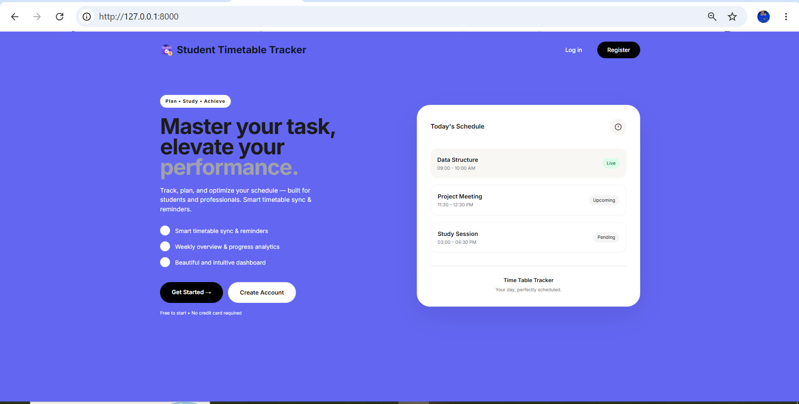
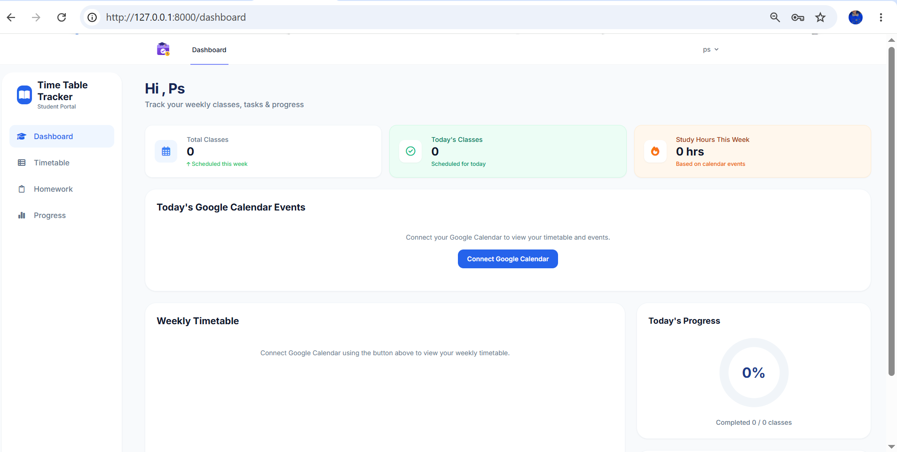

# Student Timetable Tracker

A student-focused web application designed to organize study schedules, track homework, and monitor academic progress.


<p align="center">
  
  
</p>

## Features

### Authentication
- User registration and login using Laravel Breeze.
- Google Login using Laravel Socialite and Google OAuth 2.0.
- Google Calendar account linking for timetable integration.

### Student Dashboard
- Responsive dashboard with sidebar and summary cards.
- Dynamic weekly timetable fetched from Google Calendar.
- Today's scheduled classes and events.
- Conditional Google Calendar connection button based on connection status.
- Informative messages when Google Calendar is not connected or no events are scheduled.
- Daily class completion tracking.
- Study progress overview.

### Homework Management
- Add homework with title, subject, description, due date, and time.
- View upcoming homework tasks.
- Edit existing homework.
- Delete homework with confirmation.
- Mark homework as Completed or Pending without page reload using Fetch API.
- Automatically identify overdue homework.
- Display homework tasks in priority order: Overdue, Pending, and Completed.

### User Interface
- Responsive layout using Tailwind CSS.
- Updated application branding and custom logo.
- Improved typography and dashboard styling.
- Interactive components using JavaScript.
- Dynamic dashboard data using Laravel Blade

## Tech Stack

| Category | Technologies |
|---|---|
| Backend | PHP, Laravel |
| Frontend | Blade Templates, Tailwind CSS, JavaScript |
| Authentication | Laravel Breeze, Laravel Socialite |
| Google Integration | Google OAuth 2.0, Google Calendar API |
| Database | SQLite |
| API Requests | Fetch API |
| Build Tools | Composer, NPM, Vite |
| Version Control | Git and GitHub |

## Prerequisites

Install the following before running the project:

- PHP and required Laravel extensions
- Composer
- Node.js and NPM
- Git
- Google Cloud account for Google OAuth and Calendar API integration

## Local Setup

### 1. Clone the repository

```bash
git clone 
cd student-timetable
```

### 2. Install PHP dependencies

```bash
composer install
```

### 3. Configure environment

```bash
copy .env.example .env
php artisan key:generate
```

Update `.env` with your local database and Google OAuth settings.

Never commit real credentials or secret keys.

### 4. Configure SQLite Database

Create the SQLite database file if it does not exist:

```bash
type nul > database/database.sqlite
```

Configure the database connection in `.env`:

```env
DB_CONNECTION=sqlite
```

Run migrations:

```bash
php artisan migrate
```

### 5. Configure Google OAuth

Set the following environment variables in `.env`:

```env
GOOGLE_CLIENT_ID=
GOOGLE_CLIENT_SECRET=
GOOGLE_REDIRECT_URI=http://127.0.0.1:8000/auth/google/callback
```

Configure the OAuth redirect URI in Google Cloud Console.

Enable the Google Calendar API and configure the required Calendar access scopes for timetable integration.

Never publish your Google client secret or access tokens.

### 6. Install frontend dependencies

```bash
npm install
npm run build
```

### 7. Start the application

In one terminal:

```bash
php artisan serve
```

In another terminal:

```bash
npm run dev
```

Open the application:

http://127.0.0.1:8000

## Current Development Status

The project currently includes:

- Working user registration and login.
- Google authentication.
- Google Calendar integration for fetching weekly timetable events.
- Dynamic dashboard timetable.
- Class completion tracking.
- Homework CRUD operations.
- AJAX-based homework completion status updates.
- Pending, Completed, and Overdue homework statuses.
- Dashboard homework sorting and progress indicators.
- Updated dashboard UI, branding, logo, and typography.

### Planned Improvements

- Dynamic study streak counter.
- Additional dashboard insights.
- Improved testing and documentation.
- Further UI and usability improvements.

## Security

- Keep `.env` out of version control.
- Never commit OAuth credentials, access tokens, or passwords.
- Use environment variables for sensitive configuration.
- Protect user-specific records through authentication and authorization.
- Configure production OAuth credentials and secure deployment settings before deployment.

## Project Purpose

This project is being developed as a practical Laravel learning project to implement authentication, third-party API integration, database operations, AJAX interactions, and dynamic dashboard functionality.

The application is designed for a focused student productivity use case.